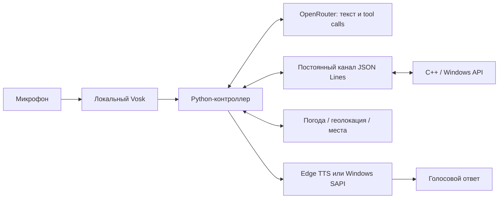

# Jarvis Core

Домашний голосовой помощник для Windows: C++-ядро, Python-контроллер,
OpenRouter с вызовом инструментов, локальное распознавание русской речи и TTS.
Версия 0.11.0-rc.1. Разработка этого инструмента ведётся отдельно от ML-менторства.

Готовый Windows x64 пакет: распакуйте ZIP из Releases и откройте JarvisPanel.exe.
Установка не требует Python, Visual Studio или CMake. Русское
[руководство](docs/USER_GUIDE.html), [лист пилота](docs/PILOT_CHECKLIST.md).
Стабильная версия 1.0 ожидает самостоятельной проверки на другом ПК.

[Защита данных](docs/PRIVACY.md): переписка не передаётся облачным ИИ,
диктовка локальная. Проверка: `python -m jarvis --privacy-check`.
[Архитектура мастера и очереди агентов](docs/AGENT_ARCHITECTURE.md).

Добавлены [профили моделей и скиллы](docs/UPGRADE_08.md),
[проверки VK](docs/UPGRADE_09.md) и [живой кодящий режим](docs/UPGRADE_10.md).
Telegram отложен владельцем из-за блокировки my.telegram.org; обычные адресаты
VK ещё требуют проверки. Бытовой этап опубликован как 0.9 RC.

В 0.7 появились сохраняемая очередь, фоновые задания, состояние и отмена.
Пример: «Джарвис, в фоне объясни, как устроен этот проект»; затем можно задать
другой вопрос. Команды и ограничения: [docs/UPGRADE_07.md](docs/UPGRADE_07.md).

В 0.6 голос воспроизводится из сетевого потока; простые реплики могут озвучиваться
по предложениям ещё во время ответа модели. Сравнение ASR и ограничения:
[docs/UPGRADE_06.md](docs/UPGRADE_06.md).

В 0.5 добавлены отдельные замеры задержек, короткие бытовые ответы и локальные
голосовые статусы выбранным тембром во время ожидания. Настройка и чтение метрик:
[docs/UPGRADE_05.md](docs/UPGRADE_05.md). План дальнейших выпусков:
[docs/RELEASE_PLAN.md](docs/RELEASE_PLAN.md).

Обновление: поиск конкретного видео YouTube, Telegram API, диалоги VK в отдельном
браузере, локальный мужской голос и мастер с кодящими исполнителями. Подключение
аккаунтов и примеры команд: [docs/UPGRADE_03.md](docs/UPGRADE_03.md).

Версия 0.4 добавляет разговор без повторного имени, контекстные продолжения,
VS Code/ONLYOFFICE, создание и заполнение DOCX, управление окнами/громкостью,
платное распознавание и голос по аудиообразцу через OpenRouter.
Настройка и ограничения: [docs/UPGRADE_04.md](docs/UPGRADE_04.md).
Дополнение: [музыка VK](docs/VK_MUSIC.md) — поиск/воспроизведение треков,
пауза, продолжение и переключение в отдельной вкладке профиля Джарвиса.

The implementation adapts the `system_doctor` probes and follows the command
separation reviewed in `evo-wnd`. Source revision and individual file hashes are
recorded in [docs/PROVENANCE.md](docs/PROVENANCE.md).

## Быстрый запуск

На текущем компьютере окружение, C++-сборка и русская модель уже установлены.
Откройте `.env` в папке проекта и заполните `OPENROUTER_API_KEY`, затем запустите:

```powershell
cd C:\Users\tima\jarvis-core
.\run.cmd
```

Можно открыть `run.cmd` двойным щелчком. Ключ считывается при запуске, поэтому
после изменения `.env` перезапустите помощника. Секреты из `.env`, виртуальное
окружение, модели и персональная конфигурация исключены из Git.

Если фоновый Джарвис уже запущен, `run.cmd` сообщит об этом. Для проверки с
видимой консолью используйте `manage.cmd foreground`: он сначала остановит
фоновый экземпляр, затем откроет помощника в текущем терминале.

```dotenv
OPENROUTER_API_KEY=ваш_ключ
OPENROUTER_MODEL=openai/gpt-4.1-mini
JARVIS_CITY=
JARVIS_TTS=edge
JARVIS_VOICE=ru-RU-DmitryNeural
```

Модель можно заменить на доступную в OpenRouter модель с поддержкой tools.
Без ключа работают простые локальные команды; свободный диалог требует ключа.
При ошибке OpenRouter выполненное действие не запускается повторно.

Примеры обращения:

- «Джарвис, состояние машины».
- «Джарвис, открой ютуб» / «Джарвис, открой сайт example.com».
- «Джарвис, открой телеграмм».
- «Джарвис, включи трек Розовое вино в VK» (после входа в VK).
- «Джарвис, поставь музыку на паузу» / «Джарвис, следующий трек».
- «Джарвис, открой вс код» → ответить на вопрос без повторного «Джарвис».
- «Джарвис, создай документ с текстом: Проверяем домашнего помощника».
- «Джарвис, заполни шаблон заявление.docx: имя — Иван, город — Дзержинск».
- «Джарвис, сверни все окна» / «сделай тише».
- «Джарвис, какая погода?».
- «Джарвис, найди кафе» / «Джарвис, куда сходить?».
- «Джарвис, выход».

Обращение можно произнести отдельно: «Джарвис», дождаться «Слушаю» и сказать
команду. После ответа можно продолжить беседу без имени в течение 40 секунд
(`JARVIS_CONVERSATION_SECONDS`, 0 отключает это). Таймер начинается после озвучивания.
«Отбой» возвращает ожидание имени; «забудь разговор» очищает контекст.
Во время выполнения команды и озвучивания микрофон закрыт: перебивание пока не поддерживается.

## Установка и диагностика

Для новой установки: Windows x64, Python 3.10+, Visual Studio 2022 с C++ и Windows
SDK, CMake, Git. Проверено на Python 3.13 x64; точные версии зависимостей сохранены
в `requirements.lock.txt`. Запустите `setup.ps1` (или команду ниже), заполните
созданный `.env`. Модель Vosk загружается с официального сайта (~45 MB).

```powershell
powershell -NoProfile -ExecutionPolicy Bypass -File .\setup.ps1
.\run.cmd -Text
.\run.cmd -Command "джарвис, состояние машины" -Mute
.\.venv\Scripts\python.exe -m jarvis --doctor
.\.venv\Scripts\python.exe -m jarvis --list-mics
.\.venv\Scripts\python.exe -m jarvis --configure
```

`--configure` предлагает скрытый ввод ключа и сохраняет локальный `.env`.
`JARVIS_MICROPHONE` позволяет выбрать номер микрофона из `--list-mics`.
Если ExecutionPolicy блокирует запуск `.ps1`, используйте `run.cmd`.

## Автозапуск и управление

На текущем компьютере задача `Jarvis-HomeAssistant` уже зарегистрирована и
запущена. Она включает помощника через 10 секунд после входа текущего пользователя
в Windows, без консольного окна и без повышения прав. При сбое Планировщик делает
до трёх попыток перезапуска с интервалом в минуту. Выход по голосовой команде или
обычная остановка не вызывают перезапуск; следующий вход в Windows запустит его снова.

Для другого компьютера установите автозапуск отдельно:

```powershell
powershell -NoProfile -ExecutionPolicy Bypass -File .\install-autostart.ps1 -StartNow
```

Управление из папки проекта:

```powershell
.\manage.cmd status
.\manage.cmd stop
.\manage.cmd start
.\manage.cmd restart
.\manage.cmd foreground
.\manage.cmd logs
```

`foreground` удобен для проверки микрофона и ошибок: после выхода через Ctrl+C
верните фоновую работу командой `manage.cmd start`. После изменения ключа, модели,
города или микрофона в `.env` выполните `manage.cmd restart`.

Один голосовой экземпляр на сеанс защищён Windows mutex; остановка передаётся
через именованное событие. Контроллер завершает текущую операцию и закрывает
микрофон и своё C++-ядро. Во время долгого сетевого запроса/TTS остановка может
занять до завершения этой операции; новые экземпляры до остановки не запускаются.

Журнал: `%LOCALAPPDATA%\Jarvis\logs\assistant.log`, до 2 MiB на файл и три резервных
файла. Содержит состояние, распознанные обращения и ответы; аудио не сохраняется.
Задачи торгового бота не меняются. Удаление только автозапуска:

```powershell
powershell -NoProfile -ExecutionPolicy Bypass -File .\install-autostart.ps1 -Uninstall
```

Уже запущенный процесс при удалении регистрации продолжает работать до
`manage.cmd stop` или выхода. Порядок ручной проверки — [TESTING.md](TESTING.md).

## Голос, местоположение и данные

Vosk локально распознаёт обращение. При `JARVIS_ASR=openrouter` активированная
голосовая реплика отправляется на `/audio/transcriptions`, модель задаётся
`JARVIS_ASR_MODEL` (на этом ПК — `elevenlabs/scribe-v2`). Фоновая речь без обращения
и вне окна диалога на этот endpoint не отправляется; микрофонные записи на диск
не сохраняются. При недоступности сервиса остаётся локальная расшифровка.
В OpenRouter отправляются текст запроса, короткая история и результаты нужных
инструментов. Данные выбранного DOCX/переписки могут входить в эти результаты.
Для TTS доступны Silero Eugene, OpenRouter с выбранным голосом/аудиообразцом и ElevenLabs.
Для голоса по образцу `JARVIS_TTS=openrouter`, `JARVIS_VOICE_REFERENCE` и
`JARVIS_TTS_MODEL=fish-audio/s2.1-pro`; образец и текст ответа отправляются провайдеру.
Исходные аудиообразцы хранятся локально вне Git. Сходство и естественность голоса
нужно оценить на слух: наличие синтеза не подтверждает совпадение с киноозвучкой.
На этом ПК пользователь выбрал вариант А по коротким русским репликам из своего
архива Jarvis Voice Pack. `JARVIS_VOICE_SAMPLES` подключает исходные WAV для точных
готовых ответов; остальная речь синтезируется по образцу. Замена голоса описана в 0.4.
Доступен также русский мужской `ru-RU-DmitryNeural` через
edge-tts: текст ответа отправляется сервису Microsoft. При его недоступности
включается установленный русский голос Windows; для постоянного локального
озвучивания задайте `JARVIS_TTS=windows`.

Местоположение выбирается в порядке: заданные `JARVIS_LATITUDE` и
`JARVIS_LONGITUDE` → заданный `JARVIS_CITY` → разрешённая геолокация Windows →
приблизительный город по IP. IP может относиться к VPN или провайдеру. Если город
определён неверно, задайте `JARVIS_CITY`; время/страна/язык системы не используются
как доказательство вашего местонахождения. Для поиска рядом с домом можно задать
обе координаты вместо центра города.

Погода берётся из Open-Meteo, места — из OpenStreetMap через Overpass. Часы работы
и доступность заведений не проверяются. При недоступности серверов списка мест
помощник возвращает ссылку на поиск по карте и сообщает об ограничении.
Источники: [Open-Meteo](https://open-meteo.com/),
[© OpenStreetMap contributors](https://www.openstreetmap.org/copyright).

Telegram определяется по обычным каталогам, реестру или уже запущенному процессу.
Для нестандартной установки задайте `JARVIS_TELEGRAM_PATH`. Локальная конфигурация
разрешённых приложений находится в `%LOCALAPPDATA%\Jarvis\kernel.json`.
Команда открытия приложения не читает переписки. Работа с диалогами и отправкой
добавлены отдельными инструментами Telegram API и требуют подключения аккаунта.

## Архитектура и инструменты



Python запускает один дочерний процесс C++ и общается через stdin/stdout UTF-8.
Каждый запрос имеет уникальный `id`, проверяется версия протокола, ожидание
ограничено тайм-аутом. Чтение stdout/stderr идёт отдельными потоками; команды
сериализуются. При обрыве/тайм-ауте канал закрывается, команда не повторяется.
Процесс завершается вместе с контроллером; открытые приложения продолжают работу.

Инструменты модели: `get_system_status`, `open_website`, `list_applications`,
`open_application`, `get_location`, `get_weather`, `find_places`.
Также доступны инструменты YouTube, диалогов и кодящих задач, описанные в обновлении 0.3.
Их аргументы проверяются по JSON Schema. Модель не получает инструмент shell;
приложения запускаются только из локального реестра, сайты — только HTTP(S).
Не более 6 запросов к модели и 12 вызовов инструментов за один запрос пользователя.

Чтобы добавить возможность, зарегистрируйте `Tool` в `jarvis/tools.py` со схемой,
описанием и обработчиком. Для новой системной операции добавьте команду в C++.
Контроллер OpenRouter и голосовой цикл при этом менять не требуется.

Проверки и практические ограничения: [docs/VALIDATION.md](docs/VALIDATION.md).
Пользовательский черновик `agent.py` оставлен отдельно; запускаемый контроллер —
пакет `jarvis`, точка входа `python -m jarvis`.

## Build and run

Windows x64, Visual Studio 2022 with Desktop development with C++, Windows SDK,
CMake 3.24+, Git. Python 3.10+ is used for native integration tests/examples, which
do not require extra Python packages. The voice assistant uses requirements.lock.txt.
Initial CMake configuration downloads nlohmann/json at a
pinned commit (v3.11.3).

```powershell
cmake -S . -B build -G "Visual Studio 17 2022" -A x64
cmake --build build --config Release --parallel
ctest --test-dir build -C Release --output-on-failure
python examples/read_snapshot.py
python examples/ctypes_snapshot.py
```

Artifacts: `build/bin/Release/jarvis-core.exe` and `jarvis_core.dll`.
The Python examples demonstrate both process isolation and direct C++ function
calls through a stable C ABI.

## Commands

| Method | Result | Changes system state |
|---|---|---|
| `ping` | Native version and readiness | No |
| `capabilities` | Tool descriptions, parameter schemas, enabled flags | No |
| `system_snapshot` | Selected metrics and threshold diagnostics | No |
| `list_processes` | Bounded top processes by CPU and working set | No |
| `list_windows` | Visible top-level windows, PID, title, executable | No |
| `get_audio` | Default playback endpoint volume/mute | No |
| `list_apps` | Registered application IDs and availability | No |
| `get_location` | Windows coordinates, accuracy, sample age, or explicit error | No |
| `open_url` | Send an HTTP(S) URL to the default browser | Yes |
| `launch_app` | Launch a registered executable; return PID | Yes |
| `stop_app` | Terminate a child launched by this kernel instance | Yes |
| `focus_window` | Request activation; report whether it succeeded | Yes |
| `set_volume` | Set default playback volume, 0–100% | Yes |
| `set_mute` | Set default playback mute | Yes |

Mutating methods are disabled by default. The trusted local controller enables
them at kernel startup using configuration or `--enable-actions`. Request JSON
cannot enable them. Built-in application IDs: `notepad`, `calc`, `mspaint`.
Register additional executable paths using a local configuration file, based on
`config.example.json`. Arguments are fixed in that startup configuration, not
accepted from individual launch requests. `process_created` reports process
creation; it does not claim that the application's UI has finished loading.
`stop_app` uses the retained process handle, not an arbitrary PID supplied by a model.
Child processes continue running when the kernel instance is destroyed.

## JSON protocol

Start `jarvis-core.exe --stdio`. Each UTF-8 JSON line receives one response line;
stdout contains protocol messages, diagnostics go to stderr. A malformed request
does not terminate the session. Requests are limited to 1 MiB.

```json
{"id":"snapshot-1","method":"system_snapshot","params":{"checks":["cpu","memory","disk","system"],"top_processes":5}}
```

Every response includes `protocol_version`, `id`, `ok`, `timestamp_utc`,
`elapsed_ms`, `result` and `error`. `--request JSON` handles a single request and
returns exit code 0 for success, 2 for a command/protocol error. Startup failures
return 1. `capabilities` exposes the authoritative parameter schemas.
`ok: true` means the command was handled; check each metric section's `available`
flag and snapshot `partial` before interpreting measurements.

Snapshot checks: `cpu`, `memory`, `disk`, `network`, `processes`, `battery`,
`startup`, `system`. Default: CPU, memory, disks, system. Sampling probes run
concurrently with a nominal 300 ms sample window. Actual CPU/process sample
durations are returned. `partial: true` marks a failed section; missing samples
are not converted into healthy zero measurements.
Network rates use the measured per-adapter interval, also returned as
`sample_window_ms`; unavailable counters remain null. Unknown battery/AC state
is represented explicitly.

Memory is reported in bytes. Disk fields inherited as `_gb` use 1024³ bytes
(GiB). Commit charge is reported separately and is not pagefile occupancy.
Process CPU is normalized across logical CPUs; its memory values are working
sets, not exclusive private memory. Protected processes can be inaccessible.
On machines with multiple processor groups the CPU probe explicitly reports
`scope: calling_processor_group`. Autostart enumeration covers the classic
registry Run keys only. Diagnostics are threshold rules, not proof of a slowdown
cause. Network/OS/disk probe details are described in the provenance notes.
OS build and display version are separate fields; `product_name_registry` is raw
registry metadata, not an asserted current Windows edition. Boot time is marked
as estimated from the current clock and uptime.

## DLL API

See [include/jarvis/c_api.h](include/jarvis/c_api.h). Use `jarvis_create`,
`jarvis_execute`, `jarvis_free_string`, `jarvis_destroy`. The DLL returns owned
UTF-8 JSON; release each returned pointer with `jarvis_free_string`. Configuration
is immutable after creation. Requests on one instance are serialized. Destroy an
instance only after all its calls finish. Invalid configuration returns a null
handle. The ctypes example contains the required argument/return declarations.

## Reference documentation

- [OpenRouter tool calling](https://openrouter.ai/docs/guides/features/tool-calling)
- [Vosk Russian models](https://alphacephei.com/vosk/models)
- [edge-tts](https://github.com/rany2/edge-tts)
- [Open-Meteo weather API](https://open-meteo.com/en/docs)
- [Overpass API](https://wiki.openstreetmap.org/wiki/Overpass_API)
- [Windows Geolocator](https://learn.microsoft.com/en-us/uwp/api/windows.devices.geolocation.geolocator)
