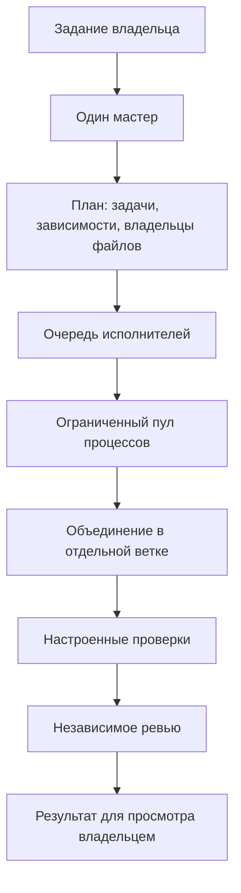

# Один мастер и очередь исполнителей

Агент — модель с ролью, собственным контекстом, инструментами и циклом
«получил задачу → выбрал действие → проверил результат → продолжил или закончил».
Он не обязан быть отдельным процессом. В Jarvis исполнители кода запускаются
отдельными процессами ради управления сроками, отменой и рабочими копиями.
Роль независимого ревьюера использует отдельный контекст модели; это не
дополнительный постоянно работающий процесс.

Одновременно работает не более одного кодящего мастера. Он заранее определяет
число помощников и связи между задачами. Для кодящего задания нужны минимум два
задания исполнителям, включая реализацию и тесты/проверку. Бытовые команды от
этого не становятся задачами для двух агентов.

Прежний предел четырёх задач снят. План по умолчанию допускает 64 задания;
JARVIS_MAX_PLAN_TASKS настраивается от 2 до 512. Это технический предел одного
ответа/плана, а не число постоянно работающих агентов. Новые задания и следующие
волны могут выполняться последовательно. Буквально бесконечного числа процессов
не бывает: остаются память, время, стоимость и ограничение размера ответа API.

JARVIS_AGENT_WORKERS=0 выбирает допуск автоматически: до четырёх одновременно,
с учётом числа CPU и свободной памяти; значение можно явно ограничить. Примерная
резервация на исполнителя — JARVIS_AGENT_MEMORY_MB=1024, ещё 1 GiB оставляется ОС
и приложениям. Это оценка допуска, не жёсткая квота памяти Windows. Очередная
волна проверяет доступную память снова. При недостатке ресурсов задачи ждут.

Закончивший процесс закрывается; для следующей задачи создаётся новый исполнитель
с отдельной рабочей копией и назначенными путями. Зависимости задаёт мастер,
поэтому этап проверки может идти после реализации. После всех задач отдельно
проходят реальные проверки и ревью. Результат автоматически не принимается в main.
Общий бюджет задачи делится между мастером, всеми исполнителями и ревьюером.

Проверка очереди создаёт шесть задач и выполняет их волнами по две с реальным Git
и тестовой командой. Модели в этом тесте заменены фикстурами; отдельные живые
демонстрации моделей описаны в VALIDATION.md.
